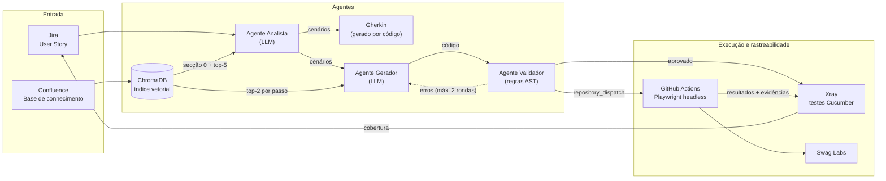
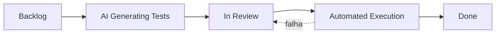
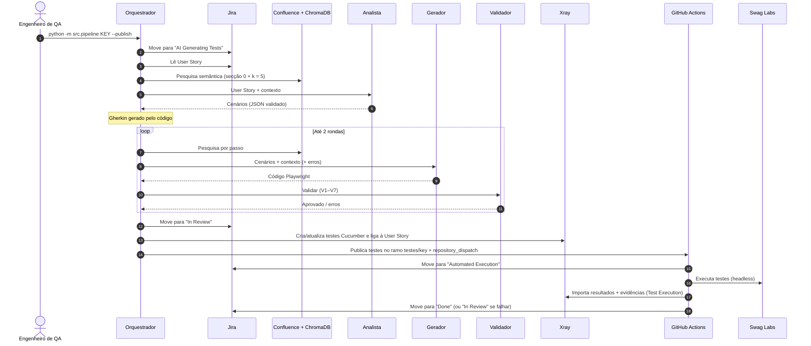

# SDLC AI QA Agent

Protótipo de agentes de IA que transforma **User Stories do Jira** em **testes E2E em Playwright**, regista-os no **Xray**, executa-os no **GitHub Actions** e devolve o resultado ao **Jira**, sem intervenção manual entre etapas.

Projeto Final da Licenciatura em Engenharia Informática — Escola Superior de Tecnologia do Instituto Politécnico de Castelo Branco (IPCB), 2026.
Aplicação de referência: [Swag Labs](https://www.saucedemo.com).

---

## Resultados

Avaliação sobre 6 User Stories × 3 execuções (`scripts/evaluate.py`):

| Métrica | Resultado |
| :--- | :---: |
| **PER** — testes executados com sucesso à primeira | **88,9 %** (56 de 62 testes) |
| **AR** — cenários conformes com os critérios de aceitação | **100 %** |
| Cobertura das regras de negócio | 92,4 % |
| Tempo médio: User Story → testes validados | **35 s** |
| **ET** — ganho face à escrita manual (estimativa 30–60 min) | **≈ 98,7 %** |
| Custo total das 18 execuções | US$ 0,0984 |

Nenhum teste gerado usou seletores fora da base de conhecimento.

---

## Como funciona



| Componente | O que faz |
| :--- | :--- |
| **Agente Analista** | Lê a User Story e o contexto recuperado e especifica os cenários de teste (JSON validado com Pydantic). Não inventa dados: o que falta fica registado como lacuna. |
| **Gherkin** | Gerado diretamente a partir dos cenários do Analista, sem LLM. |
| **Agente Gerador** | Escreve o código Playwright (uma função por cenário), com pesquisa na base de conhecimento para cada passo. |
| **Agente Validador** | Analisa o código com o módulo `ast`, sem LLM, com 7 regras (V1–V7): sintaxe, imports, chamadas proibidas, seletores existentes na base de conhecimento, asserções `expect`, um teste por cenário e navegação inicial. |
| **Orquestrador** | Executa o fluxo completo e regista tempo, tokens e custo por etapa (`pipeline.json`). |
| **Integrações** | Xray (GraphQL + OAuth2), ligação "tests / is tested by" no Jira, `repository_dispatch` no GitHub e movimento automático no quadro Kanban. |

### Quadro do Jira



<details>
<summary><b>Diagrama de sequência completo</b></summary>



</details>

---

## Tecnologias

| Área | Tecnologia |
| :--- | :--- |
| Linguagem | Python 3.12 (WSL2, Ubuntu 24.04) |
| Testes E2E | Playwright + pytest |
| Modelo de linguagem | Claude Haiku via [LiteLLM](https://github.com/BerriAI/litellm) (fornecedor configurável em `LLM_MODEL`) |
| RAG | ChromaDB + `intfloat/multilingual-e5-small` (embeddings locais) |
| Validação de dados | Pydantic |
| Gestão | Jira Cloud, Confluence Cloud, Xray Cloud |
| CI/CD | GitHub Actions |

---

## Estrutura do repositório

```text
sdlc-ai-qa-agent/
├── .github/workflows/      # Pipeline de execução dos testes gerados
├── docs/screenshots/       # Evidências recolhidas durante o desenvolvimento
├── knowledge/              # Base de conhecimento do Swag Labs e recolha manual (DevTools)
├── outputs/<KEY>/          # Artefactos de cada User Story (análise, .feature, testes, métricas)
├── requirements/           # User Stories (requisitos como código)
├── scripts/                # Pontos de entrada de linha de comandos
├── src/
│   ├── agents/             # Analista, Gerador, Validador, Gherkin e modelos Pydantic
│   ├── integrations/       # Jira, Xray, quadro Kanban e GitHub
│   ├── llm/                # Chamadas ao LLM com saída estruturada e ciclo de correção
│   ├── rag/                # Leitura do Confluence, segmentação e índice vetorial
│   └── pipeline.py         # Orquestrador do fluxo completo
├── tests/
│   ├── baseline/           # Smoke test do ambiente
│   └── unit/               # Testes unitários (Validador, envio ao Xray)
├── .env.example            # Modelo das variáveis de ambiente (sem segredos)
├── requirements.txt        # Dependências para execução local
└── requirements-ci.txt     # Dependências mínimas da pipeline
```

---

## Instalação

```bash
git clone https://github.com/antonio-vilasboas/sdlc-ai-qa-agent.git
cd sdlc-ai-qa-agent
python3.12 -m venv venv && source venv/bin/activate
pip install -r requirements.txt
playwright install chromium

cp .env.example .env        # preencher as credenciais
python scripts/sanity_check.py   # valida Jira, Confluence, Xray e LLM
```

| Variável | Para quê |
| :--- | :--- |
| `ATLASSIAN_BASE_URL`, `ATLASSIAN_USER_EMAIL`, `ATLASSIAN_API_TOKEN` | Jira e Confluence |
| `JIRA_PROJECT_KEY`, `CONFLUENCE_SPACE_KEY` | Projeto e espaço usados |
| `XRAY_CLIENT_ID`, `XRAY_CLIENT_SECRET` | Xray Cloud (OAuth2) |
| `ANTHROPIC_API_KEY`, `LLM_MODEL` | Modelo de linguagem |
| `GITHUB_REPOSITORY`, `GITHUB_DISPATCH_TOKEN` | Disparo da pipeline (token com acesso só a este repositório) |

---

## Utilização

**Preparar a base de conhecimento** (uma vez, ou quando a página do Confluence mudar):

```bash
python scripts/publish_confluence_kb.py   # publica knowledge/swaglabs_knowledge_base.md
python scripts/verify_kb.py               # compara com a recolha manual
python scripts/ingest_kb.py               # indexa no ChromaDB e avalia a recuperação
```

**Gerar testes para uma User Story:**

```bash
python -m src.pipeline QAAGENT-6            # Analista → Gherkin → Gerador ⇄ Validador
pytest outputs/QAAGENT-6/test_qaagent_6.py -v
```

**Ciclo completo** (Xray + GitHub Actions + quadro do Jira):

```bash
python -m src.pipeline QAAGENT-6 --publish
```

**Avaliação** (AR, PER, ET):

```bash
python scripts/evaluate.py --runs 3
python scripts/evaluate.py --summarize --t-manual QAAGENT-1=45   # (repetir por User Story)
```

<details>
<summary>Outros scripts</summary>

| Script | Função |
| :--- | :--- |
| `publish_user_stories.py` | Publica as User Stories no Jira (ADF, idempotente) |
| `run_analyst.py` / `run_generator.py` / `run_validator.py` | Executa cada agente isoladamente |
| `publish_tests_xray.py` | Regista os testes no Xray e liga-os à User Story |
| `report_xray.py` | Envia resultados JUnit e evidências para o Xray |
| `move_story.py` | Move uma User Story no quadro (ex.: repor em Backlog) |

</details>

---

## Segurança

- O ficheiro `.env` está excluído do Git. O repositório só tem o modelo `.env.example`.
- Na pipeline, as credenciais estão em **GitHub Secrets**. O workflow tem apenas permissão de leitura, e cada segredo só é exposto ao passo que o usa.
- O token de disparo é *fine-grained*, limitado a este repositório.
- As credenciais são tratadas como `SecretStr` (Pydantic) e nunca aparecem em registos.

---

## Limitações conhecidas

- A validação é estática: não deteta testes bem escritos que não cumprem o comportamento pretendido (ex.: saltar o login).
- A base de conhecimento foi construída à medida das 6 User Stories avaliadas.
- O tempo manual da métrica ET é uma estimativa, não foi cronometrado.

---

## Nota

O desenvolvimento contou com apoio de ferramentas de IA generativa. As decisões de arquitetura, as regras de negócio e a validação dos resultados são da responsabilidade do autor.

**Autor:** António Vilas Boas · **Orientação:** Prof. Luís Barata · **Coorientação:** Prof. Doutor Eurico Lopes
