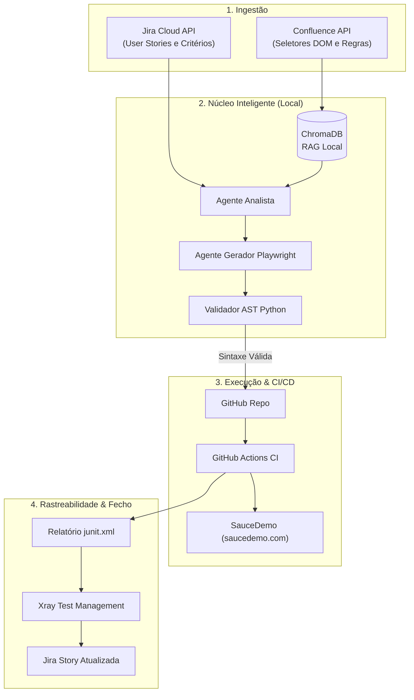

# SDLC AI QA Agent

Protótipo de Agente de IA para criação, validação sintática e execução contínua de testes E2E integrado no ciclo de vida de desenvolvimento de software (SDLC).

---

## 1. Arquitetura e Fluxo de Integração

O ecossistema liga requisitos de negócio no Jira, documentação técnica no Confluence, motor RAG local com ChromaDB, geração de testes Playwright e reporte automático no Xray via GitHub Actions.



---

## 2. Componentes da Solução

| Módulo | Tecnologia | Função no SDLC |
| :--- | :--- | :--- |
| **Ingestão de Requisitos** | Jira Cloud REST API | Leitura das User Stories e critérios de aceitação. |
| **Base de Conhecimento** | Confluence Cloud REST API | Catálogo de seletores e especificação técnica. |
| **Motor RAG Local** | ChromaDB + Sentence Transformers | Pesquisa vetorial para contextualizar o modelo sem alucinações. |
| **Multi-Agente IA** | Python (LiteLLM / Gemini API) | Análise funcional, geração de código e validação de AST. |
| **Framework E2E** | Playwright Python + pytest | Execução dos testes automatizados no browser. |
| **Pipeline CI/CD** | GitHub Actions | Execução headless em contentor Linux a cada alteração. |
| **Gestão de Testes** | Xray Cloud REST API | Criação das execuções de teste e fecho de cobertura no Jira. |

---

## 3. Estrutura do Repositório

```text
sdlc-ai-qa-agent/
├── .github/workflows/    # Pipelines de CI/CD (GitHub Actions)
├── config/               # Configurações do projeto
├── docs/screenshots/     # Evidências e capturas para o relatório
├── src/
│   ├── agents/           # Agentes de IA (Analyst, Generator, Validator)
│   ├── execution/        # Integração com a API do Xray
│   ├── ingestion/        # Clientes de API para Jira e Confluence
│   └── rag/              # Base vetorial ChromaDB
├── tests/
│   ├── baseline/         # Testes de referência de sanidade
│   └── generated/        # Casos de teste gerados pela IA
├── requirements.txt      # Dependências Python do projeto
└── .env.example          # Modelo de variáveis de ambiente
```

---

## 4. Pré-requisitos e Execução Rápida

1. **Ativar o ambiente virtual Python:**
   `source venv/bin/activate`
2. **Instalar dependências e browser:**
   `pip install -r requirements.txt`  
   `playwright install chromium`
3. **Correr o smoke test de baseline:**
   `pytest tests/baseline/test_saucedemo_smoke.py --headed`